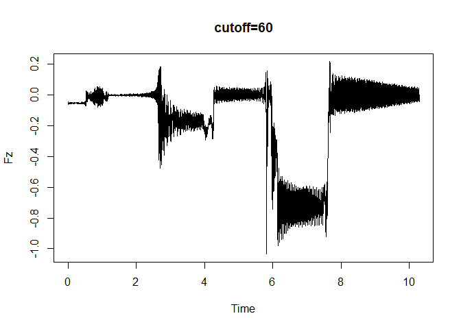

<!-- README.md is generated from README.Rmd. Please edit that file -->

<!-- Render to README.md with `devtools::build_readme()` -->

# ForcePlatteR

<!-- badges: start -->

<!-- badges: end -->

The goal of ForcePlatteR is to …

## Installation

You can install the development version of ForcePlatteR from
[GitHub](https://github.com/) with:

``` r
# install.packages("pak")
pak::pak("crankin-star/ForcePlatteR")
```

## Example

This is a basic example which shows you how to solve a common problem:

``` r
library(ForcePlatteR)

masses
#> Force plate data with 8 channels
#>          Time CZ(Volts) DZ(Volts)  AZ(Volts)  BZ(Volts)  YAC(Volts) XDC(Volts)
#> 0       0e+00 -0.115422 -0.148921 -0.0452042 -0.0619534 -0.00204257 0.00246685
#> 1       2e-04 -0.115422 -0.148921 -0.0461705 -0.0609871 -0.00236467 0.00278895
#> 2       4e-04 -0.114778 -0.148599 -0.0458484 -0.0619534 -0.00236467 0.00343315
#> 3       6e-04 -0.115744 -0.148599 -0.0455263 -0.0603429 -0.00204257 0.00375525
#> 4       8e-04 -0.115100 -0.148599 -0.0461705 -0.0613092 -0.00139837 0.00472156
#> 5       1e-03 -0.115422 -0.147954 -0.0461705 -0.0606650 -0.00139837 0.00472156
#>         XAB(Volts) YBD(Volts)
#> 0       0.00504366  0.0494936
#> 1       0.00504366  0.0491715
#> 2       0.00472156  0.0475610
#> 3       0.00439946  0.0472389
#> 4       0.00472156  0.0462726
#> 5       0.00472156  0.0446621
#> Scan rate: 5000  Scans per Frame:10  Total scans: 51460
A1840
#> $SN
#> [1] 1840
#> 
#> $MN
#> [1] "HE6X6-1"
#> 
#> $DATE
#> [1] "10/26/2020"
#> 
#> $LENGTH
#> [1] 6
#> 
#> $WIDTH
#> [1] 6
#> 
#> $XOFFSET
#> [1] 0
#> 
#> $YOFFSET
#> [1] 0
#> 
#> $ZOFFSET
#> [1] 0.439213
#> 
#> $S
#>           S1         S2         S3         S4        S5         S6         S7
#> 1  0.0025060 -0.0051789 -0.0029982  0.0017707 0.0000271 -0.0532926  0.0531128
#> 2  0.0002548 -0.0016677 -0.0019367  0.0043635 0.0532233  0.0001949 -0.0001942
#> 3 -0.0780750 -0.0758160 -0.0752487 -0.0768511 0.0003307  0.0012481 -0.0001544
#> 4  0.2227649  0.2261377 -0.2182328 -0.2259189 0.0000000  0.0000000  0.0000000
#> 5  0.2318205 -0.2293637  0.2144642 -0.2158198 0.0000000  0.0000000  0.0000000
#> 6 -0.0055007 -0.0053416 -0.0053016 -0.0054145 0.1871082 -0.1917968 -0.1911500
#>           S8
#> 1  0.0000278
#> 2  0.0546583
#> 3  0.0000142
#> 4  0.0000000
#> 5  0.0000000
#> 6 -0.1921531
#> 
#> attr(,"class")
#> [1] "acl"

df <- masses$data
S <- A1840$S

# We can usually get offsets from the GUI selector
offset <- c(-0.002, -0.169, -0.204, -0.218, 0.006, -0.041, -0.046, -0.017)
df[-1] <- sweep(df[-1], 2, offset, `-`) # excluding time column

forces <- calculate_forces(df, S)

# plot.force_output(forces, component = "Fz")
```

## Typical workflow

1.  read in your au2 file

``` r
fp <- au2_example("jump.au2")
au2 <- read_au2(fp)

au2
#> Force plate data with 8 channels
#>          Time CZ(Volts) DZ(Volts)  AZ(Volts)  BZ(Volts)  YAC(Volts) XDC(Volts)
#> 0       0e+00 -0.115422 -0.148921 -0.0452042 -0.0619534 -0.00204257 0.00246685
#> 1       2e-04 -0.115422 -0.148921 -0.0461705 -0.0609871 -0.00236467 0.00278895
#> 2       4e-04 -0.114778 -0.148599 -0.0458484 -0.0619534 -0.00236467 0.00343315
#> 3       6e-04 -0.115744 -0.148599 -0.0455263 -0.0603429 -0.00204257 0.00375525
#> 4       8e-04 -0.115100 -0.148599 -0.0461705 -0.0613092 -0.00139837 0.00472156
#> 5       1e-03 -0.115422 -0.147954 -0.0461705 -0.0606650 -0.00139837 0.00472156
#>         XAB(Volts) YBD(Volts)
#> 0       0.00504366  0.0494936
#> 1       0.00504366  0.0491715
#> 2       0.00472156  0.0475610
#> 3       0.00439946  0.0472389
#> 4       0.00472156  0.0462726
#> 5       0.00472156  0.0446621
#> Scan rate: 5000  Scans per Frame:10  Total scans: 51460

df <- au2$data
```

2.  Find your calibration file or use one of the pre-loaded files (A1840
    for analog, D1840 for digital)

``` r
cfg <- read_config("calibration_data/A1840_1.acl")
S <- cfg$S
```

3.  Select the offset interval and weight intervals

``` r
offset_interval <- select_range_gui(
  df,
  x = "Time", y = "Ch.00",
  viewer = "browser"
)
offset <- df[df$Time < offset_interval$upper & df$Time > offset_interval$lower, -1] |>
  colMeans()
df[-1] <- sweep(df[-1], 2, offset, `-`)

weight_interval <- select_range_gui(
  df,
  x = "Time",
  y = "Ch.00",
  viewer = "browser"
)
```

4.  Calculate forces

``` r
forces <- calculate_forces(df, S)
```

5.  Filter high frequencies.

``` r
time <- df$Time
forces[, colnames(forces) != "Time"] |>
  lapply(\(x) low_pass_fourier(time = time, x = x, cutoff = 60)) |>
  do.call(cbind, args = _) |>
  as.data.frame() |>
  head()
#>             Fx          Fy          Fz          Mx          My          Mz
#> 1 -0.008938216 0.006932714 -0.01264460 -0.04971790 -0.01061717 -0.01292663
#> 2 -0.009157567 0.006737937 -0.01277394 -0.05184453 -0.01113205 -0.01370721
#> 3 -0.009327472 0.006541273 -0.01288451 -0.05395237 -0.01166320 -0.01450106
#> 4 -0.009448941 0.006343597 -0.01297629 -0.05603771 -0.01220978 -0.01530658
#> 5 -0.009523146 0.006145767 -0.01304930 -0.05809689 -0.01277085 -0.01612218
#> 6 -0.009551406 0.005948616 -0.01310365 -0.06012639 -0.01334543 -0.01694617
# OR
filtered_forces <- low_pass_fourier.df(forces)
head(filtered_forces)
#>                  Fx         Fy          Fz         Mx          My         Mz
#> 0       -0.08718767 0.04866400 -0.04385037 0.02338917 -0.04395054 0.04943003
#> 1       -0.09146666 0.05061507 -0.04549293 0.02570775 -0.04567678 0.05149526
#> 2       -0.09569242 0.05259106 -0.04706135 0.02807487 -0.04732782 0.05358042
#> 3       -0.09985709 0.05458679 -0.04855396 0.03048378 -0.04890155 0.05567970
#> 4       -0.10395304 0.05659702 -0.04996936 0.03292761 -0.05039609 0.05778729
#> 5       -0.10797286 0.05861649 -0.05130644 0.03539945 -0.05180990 0.05989736
#>          Time
#> 0       0e+00
#> 1       2e-04
#> 2       4e-04
#> 3       6e-04
#> 4       8e-04
#> 5       1e-03
```

6.  Visualize and analyze as needed.

``` r
plot(filtered_forces, component = "Fz")
```


